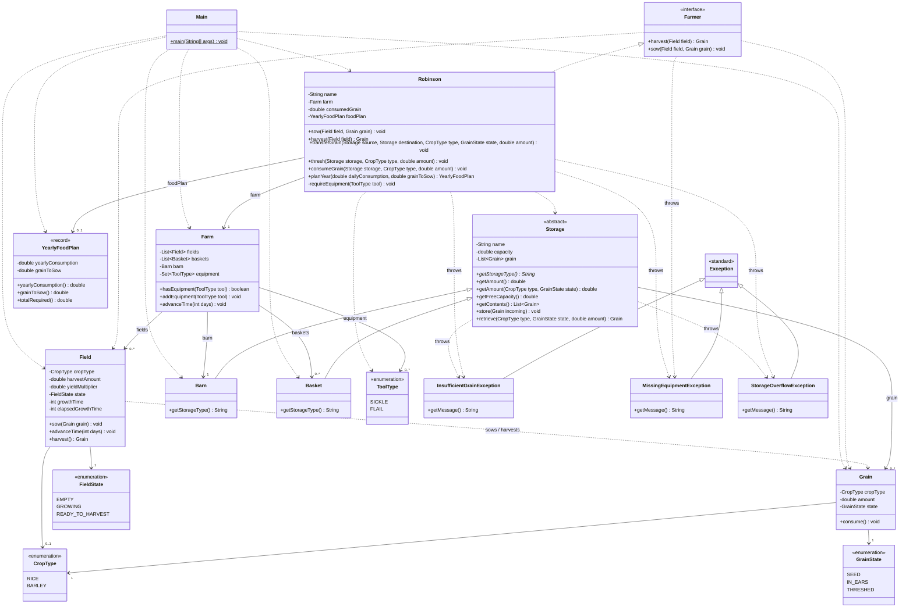

# Диаграмма классов объектной модели

Показаны все 17 типов проекта и стандартный класс Exception. Указаны основные поля и методы; конструкторы, обычные геттеры и переопределения методов Object опущены для читаемости.

Сплошные стрелки обозначают хранимые ссылки, пунктирные — зависимости. Связи Farm с переданными в конструктор объектами показаны как ассоциации: их жизненный цикл не привязан к ферме.

`+` — public, `-` — private, `$` — static, `*` у метода — abstract.

`Farmer <|.. Robinson` — реализация интерфейса; `Storage <|-- Barn` и `Storage <|-- Basket` — наследование. Собственные исключения наследуются от Exception и являются проверяемыми. Метки `throws` обозначают зависимости от объявленных исключений.

Пакеты соответствуют каталогам src: character, farm, model, storage, enums, exception. Main находится в пакете по умолчанию. YearlyFoodPlan — record; его компоненты доступны через методы yearlyConsumption() и grainToSow().

